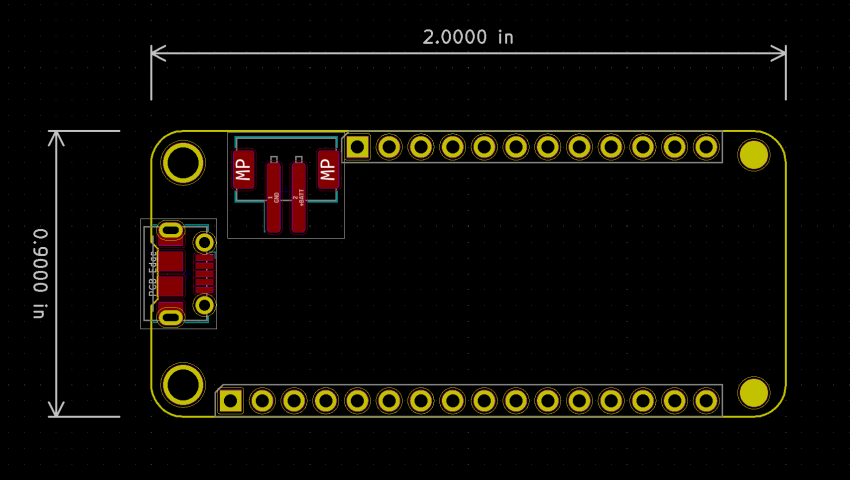

# Adafruit Feather KiCad template

A KiCad project template for designing boards around the [Adafruit Feather specification](https://learn.adafruit.com/adafruit-feather/feather-specification). It provides the board outline, mounting holes, 12-pin and 16-pin headers, a Micro-USB connector, and a two-pin JST PH battery connector.



## Status

This is a starting layout, with no routed PCB tracks. Add your own controller, power circuitry, and application circuit before fabrication. The checked-in PCB was saved by KiCad 5.1.2; its legacy schematic and project formats are retained. The [correctness audit](docs/code-audit-report.md) confirms schematic/PCB connector-net agreement and records remaining ERC, DRC, and mounting-hole concerns. It does not establish electrical or manufacturing validation.

## Use the template

```sh
git clone https://github.com/makeristic/Adafruit_Feather.git
```

1. Copy the `Adafruit_Feather` directory, including `meta/`, into your KiCad user templates directory. The archived [KiCad 5.1 template-location documentation](https://docs.kicad.org/5.1/en/kicad/kicad.html#template_locations) describes the directory layout.
2. In KiCad, create a project from a template and select this template under User Templates. Alternatively, open [Adafruit_Feather.pro](Adafruit_Feather.pro) to inspect the source.
3. Install KiCad's standard symbol, footprint, and 3D-model libraries. The source uses standard `Connector`, `Connector_Generic`, and `power` symbols and connector footprints. Retain the supplied `-cache.lib` when opening the legacy schematic. Models reference `${KISYS3DMOD}`; when using a newer release, check that this legacy path variable points to your installed 3D-model directory and resolve any changed model filenames.
4. Work in a copy when opening with a newer KiCad release, which may convert the legacy files. Review the Feather pinout, connector orientation, and power circuitry, then run ERC and DRC on your completed design.

## Files

- [Adafruit_Feather.sch](Adafruit_Feather.sch): legacy schematic with connector pin labels.
- [Adafruit_Feather.kicad_pcb](Adafruit_Feather.kicad_pcb): board outline and placed footprints.
- [Adafruit_Feather-cache.lib](Adafruit_Feather-cache.lib): cached schematic symbols.
- [meta/](meta/): KiCad template description, icon, and board preview.

No firmware, BOM export, or Gerber fabrication package is included.

## Related projects and contributions

Use [Adafruit_Feather_USB-C](https://github.com/makeristic/Adafruit_Feather_USB-C) for the USB-C variant. [Feather_STM32WB55](https://github.com/makeristic/Feather_STM32WB55) is a separate STM32WB55 board design; [Makeristic-KiCad-Library](https://github.com/makeristic/Makeristic-KiCad-Library) contains additional parts.

Report problems through [GitHub issues](https://github.com/makeristic/Adafruit_Feather/issues), including your KiCad version and any missing-library messages. For layout changes, include schematic or board screenshots and explain any change to Feather compatibility.

## Attribution and licence

Original template copyright © 2019 [arturo182](https://twitter.com/arturo182), from [KiCad/kicad-templates pull request #23](https://github.com/KiCad/kicad-templates/pull/23/files#diff-a7a7ac8a622f8aa19b54fb2f3cf42329). This Makeristic repository preserves that template and its attribution.

The [upstream licence at the source revision](https://github.com/KiCad/kicad-templates/blob/459d6bc93c55cfdac9f9b5d629b44cb891b5f2b8/LICENSE.md) is Creative Commons Attribution-ShareAlike 4.0 with the KiCad library exception. A copy is included in [LICENSE.md](LICENSE.md). The existing template has not been relicensed to MIT; consult the licence for the distinction between using library data in a design and redistributing the template collection.
